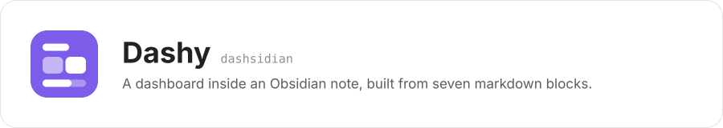
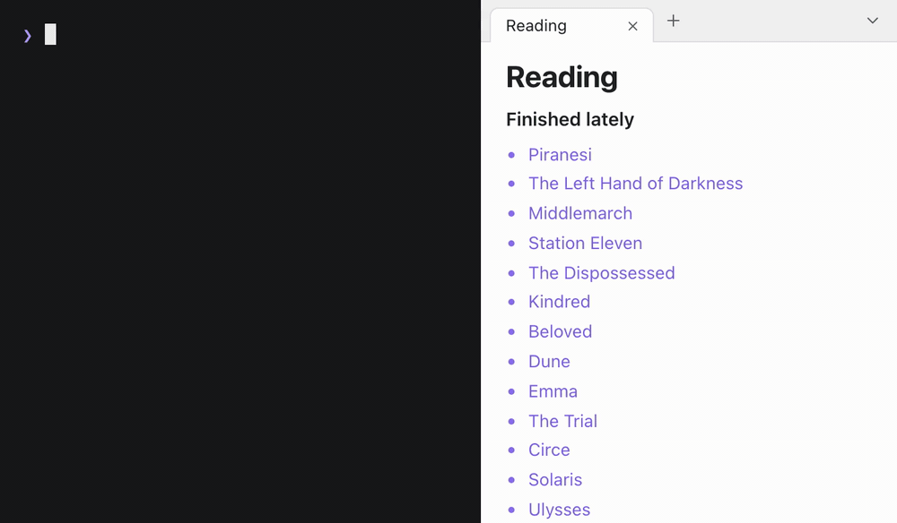
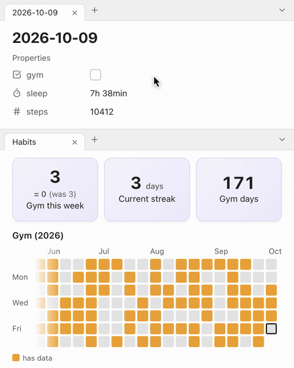
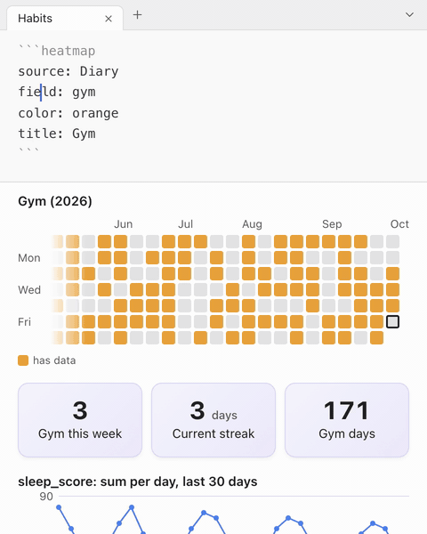
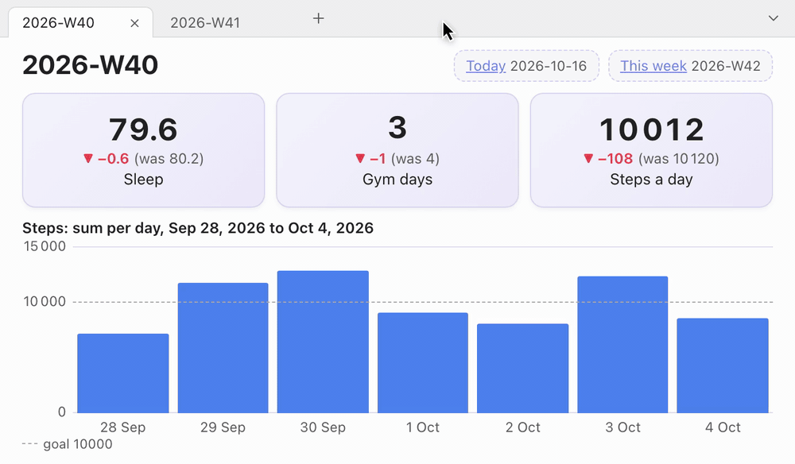
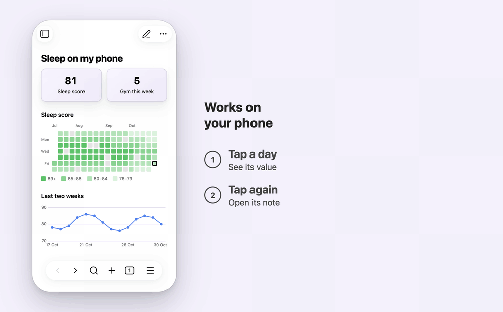
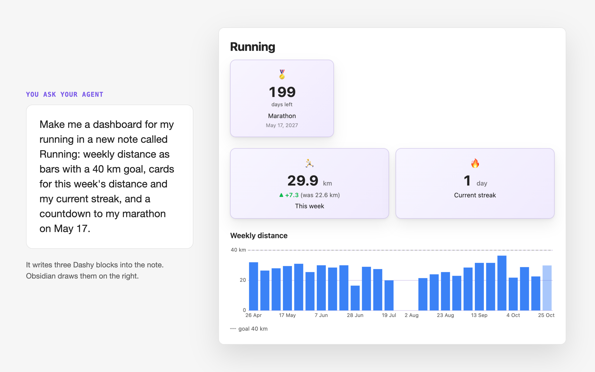

# Dashy

<picture>
  <source media="(prefers-color-scheme: dark)" srcset="https://raw.githubusercontent.com/Dimagious/dashsidian/HEAD/docs/banner-dark.svg">
  
</picture>

[](https://community.obsidian.md/plugins/dashsidian)
[](https://github.com/Dimagious/dashsidian/releases)
[](https://github.com/Dimagious/dashsidian/stargazers)

**Describe the dashboard you want. Your AI agent builds it in your note.**

Charts, streaks, heatmaps and goals from your daily notes' properties.
Plain YAML you can read and edit. No JavaScript, no Dataview, works on your phone.



**Install:** Settings → **Community plugins** → **Browse** → search for **Dashy**. Then install the agent skill from Dashy's settings, under **AI agent skill**, and ask for what you want to see. Works with Claude Code, Codex, Cursor and other agents.

[Website](https://dimagious.github.io/dashsidian/) · [Every block and key](https://dimagious.github.io/dashsidian/reference/) · [Guides](https://dimagious.github.io/dashsidian/guides/) · [Changelog](https://github.com/Dimagious/dashsidian/blob/master/CHANGELOG.md)

## What you can do

**Tick a box, the numbers follow.** Every block redraws when a note changes. No agent needed: [a habit tracker in two blocks](https://dimagious.github.io/dashsidian/guides/habit-tracker-without-dataview/).

**A broken block says why.** A typo gets a "did you mean", a broken YAML line gets its line number. Your agent can read the same messages and fix the block.

<p>
  
  
</p>

**A review counts its own week.** A note named `2026-W40` shows that week, however late you open it, and the same template works every week: [a weekly review without Dataview](https://dimagious.github.io/dashsidian/guides/weekly-review-without-dataview/).



**Works on your phone.** A tap on a heatmap cell or a chart bar shows its value, and a second tap opens the note.



**Read and edit what it writes.** Plain YAML, no JavaScript, no Dataview. [Setup and six prompts to copy](https://dimagious.github.io/dashsidian/guides/ai-agent-dashboard/).

````markdown
```progress
source: Books
date_field: finished
period: year
items:
  - { label: Books this year, agg: count, goal: 24 }
```
````

<sub>The phone clip is the plugin running in Obsidian's mobile interface, in a phone-sized window on a desktop, with a demo vault. The other clips are drawn illustrations with made-up data. The picture below is a real note in a demo vault.</sub>

## Seven blocks

<picture>
  <source media="(prefers-color-scheme: dark)" srcset="https://raw.githubusercontent.com/Dimagious/dashsidian/HEAD/docs/screens/agent-hero-dark.png">
  
</picture>

- [`stats`](https://dimagious.github.io/dashsidian/reference/stats/): number cards, streaks, this week against last.
- [`progress`](https://dimagious.github.io/dashsidian/reference/progress/): bars towards a goal.
- [`heatmap`](https://dimagious.github.io/dashsidian/reference/heatmap/): a year of days, several habits on one grid, or a month as a calendar.
- [`chart`](https://dimagious.github.io/dashsidian/reference/chart/): a line or bars by day, week, month or year, with a goal line.
- [`countdown`](https://dimagious.github.io/dashsidian/reference/countdown/): days until a race, a holiday or the next birthday.
- [`today`](https://dimagious.github.io/dashsidian/reference/today/): the date and links to your daily, weekly and monthly notes.
- [`tiles`](https://dimagious.github.io/dashsidian/reference/tiles/): link tiles into the vault, with live note counts.

Blocks take their colours from your theme and read frontmatter only, not inline `key:: value` fields. Pie charts, tables, kanban and tasks are left to other plugins: [what it leaves out](https://dimagious.github.io/dashsidian/#scope).

## Questions

<details>
<summary>What does my agent see, and where does it go?</summary>

Your agent reads the notes it opens and sends them to its model provider, as it does with any
file it works on. Check what it is allowed to open before you point it at a vault with private
notes. Dashy makes no network requests, apart from a tile `image` you set to an
`https://` address. It writes the skill files and `.dashy/` only when you ask, and
`.dashy/vault-profile.md` holds one real value of each property, so read it before you hand it
over. [The details](https://dimagious.github.io/dashsidian/guides/ai-agent-dashboard/#privacy).

</details>

<details>
<summary>Do I need an AI agent?</summary>

No. **Dashy: Insert block** puts a working example at the cursor, already pointed at a folder and
a property from your vault. Every block is a few lines of YAML.

</details>

<details>
<summary>Does it work on a phone?</summary>

Yes. A tap on a heatmap cell or a chart bar shows its value, and a second tap opens the note.

</details>

<details>
<summary>How does a block know a note's date?</summary>

From its name. `2026-01-05 Monday` counts, and so does `05.01.2026` when that is the day format in
your Daily notes or Periodic Notes settings. A block can also name a format with `date_format`, or read a property with `date_field`.

</details>

<details>
<summary>Which languages does it speak?</summary>

English, Russian, German, French and Spanish, following Obsidian or picked in the settings.

</details>

## Bugs and ideas

The settings tab has a row for each, and it fills in your versions. Or go straight to [the issue tracker](https://github.com/Dimagious/dashsidian/issues).

<details>
<summary>Development</summary>

```bash
npm install
npm test             # vitest, with coverage gates
npm run lint         # eslint + eslint-plugin-obsidianmd
npm run typecheck
npm run build        # main.js + styles.css
npm run dev:vault    # build into a test vault and watch
```

Logic lives in `src/core/`, which imports neither Obsidian nor the DOM. Block keys live in
[`src/blocks/schema.json`](https://github.com/Dimagious/dashsidian/blob/master/src/blocks/schema.json); the agent skill and the site's
reference pages are generated from it. Design notes: [`docs/SPEC.md`](https://github.com/Dimagious/dashsidian/blob/master/docs/SPEC.md).

</details>

## License

[MIT](https://github.com/Dimagious/dashsidian/blob/master/LICENSE) © Dmitriy Yurkin
